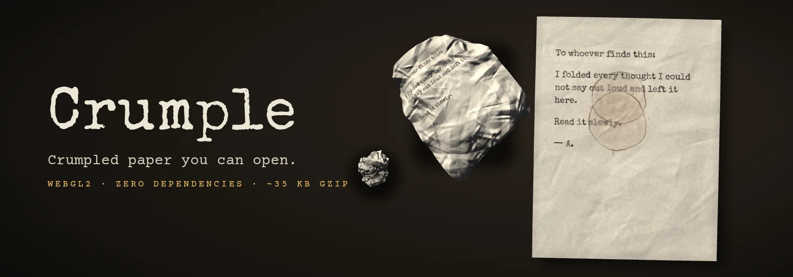
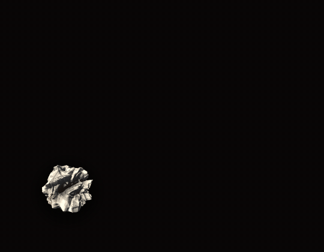
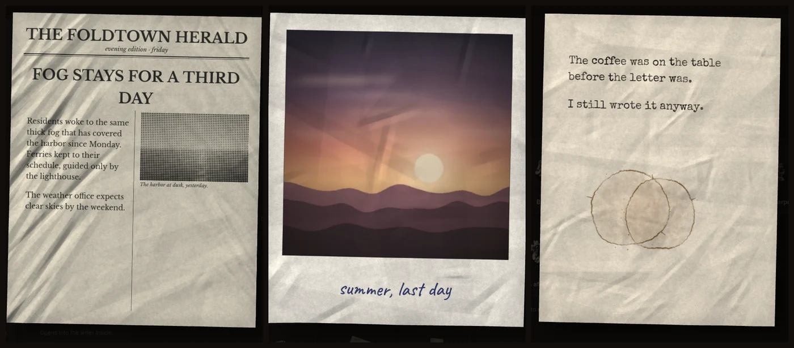

# 📄 Crumple

**English** · [Português](./README.pt-BR.md)

<p align="center">
  
  
  
  
</p>

<p align="center">
  
  
  
  
  
  
  
</p>

<p align="left">
  <strong>Crumpled paper you can open.</strong><br />
  A dependency-free WebGL2 library: a crumpled note flies to the center of the screen and unfolds into a readable sheet, with creases, ink and a back side.
</p>



> Hide notes, letters and clues around a page and let each reader unfold them. **Live demo:** [devandreotti.github.io/crumple](https://devandreotti.github.io/crumple/)

---

## Overview

**Crumple** turns any button into a crumpled sheet of paper. On click the paper leaves its spot along an arc, reaches the center of the screen and opens into a sheet you can read, with the creases catching the light. Closing it crumples the sheet again and returns it to where it was.

What the library does:

1. **Crumples for real**: 7 closed shapes (ball, flat, folded in quarters, folded in half, folded in thirds, rolled and twisted), deformed on the GPU. The creases stay visible on the open sheet.
2. **Prints the content**: 10 paper types (typewritten sheet, notebook, continuous form, thermal receipt, theatre ticket, office memo, newspaper clipping, sticky note, instant photo and a sealed envelope with a letter inside). The text has headings, struck-out words with handwritten corrections and redaction bars.
3. **Wears and ages**: 14 states, from torn and burnt to coffee, wine, ink blots, foxing, tape, rubber stamps and sun-faded paper. Stains show through the sheet and reappear on the back.
4. **Animates everything**: flight, unfolding, flipping at any moment, tearing ticket stubs, burning after reading, a flashlight that reveals hidden ink, drag or pinch to open, and optional synthesized paper sounds.

The focus is being light (about 35 KB gzip, nothing else to install), with a CSS version when the browser has no WebGL2, respect for `prefers-reduced-motion`, keyboard use and screen readers.

---

## Demo

<p align="center">
  
</p>

Still image of three opened papers, rendered by the library: a newspaper clipping, an instant photo and a typed sheet with a coffee stain.

<p align="center">
  
</p>

Try it in the browser at [devandreotti.github.io/crumple](https://devandreotti.github.io/crumple/). The page has a gallery of types, shapes and states, and a playground that writes the configuration as JSON.

---

## Flow

```mermaid
flowchart LR
    A["Button on the page<br/>(still image)"] --> B["Trigger nears the view<br/>builds the paper"]
    B --> C["Worker: creases and burn<br/>Canvas 2D: printing"]
    C --> D["Click: arc flight<br/>to the screen center"]
    D --> E["Unfolds in the<br/>vertex shader"]
    E --> F["Reading: flip, tear,<br/>flashlight, drag"]
    F --> G["Close: crumples and flies back<br/>(or burns away for good)"]

    classDef dark fill:#450a0a,color:#fff,stroke:#7f1d1d
    classDef red fill:#b91c1c,color:#fff,stroke:#7f1d1d
    classDef hot fill:#dc2626,color:#fff,stroke:#b91c1c
    classDef orange fill:#f97316,color:#111827,stroke:#ea580c
    classDef amber fill:#f59e0b,color:#111827,stroke:#d97706
    class A dark
    class B,C red
    class D hot
    class E,F orange
    class G amber
    linkStyle default stroke:#7f1d1d,stroke-width:2px
```



---

## Who is it for

- Narrative sites, ARGs and treasure hunts that hide clues around the page
- Invitations, letters and digital time capsules that ask for a tactile detail
- Web games, escape rooms and creative portfolios
- Anyone who wants realistic paper without loading three.js or a physics engine

---

## Stack

- **JavaScript (ES2020 modules)** for the library, with no runtime dependencies
- **WebGL2 / GLSL ES 3.00** to bend the sheet, light the creases, burn and draw the particles
- **Canvas 2D** to print text, backgrounds, stains and cut-outs on each side of the paper
- **Web Workers** to compute the crease and burn fields off the main thread
- **Web Audio** for the synthesized paper sounds (real recordings are optional)
- **esbuild** to build `dist/` (development only)
- **puppeteer-core** for the browser tests and the prerender tool (development only)
- **Python 3 + Pillow** to regenerate the procedural textures in `assets/` (optional)

---

## Prerequisites

*   [x] **A browser with WebGL2**: current Chrome, Edge, Firefox and Safari. Without WebGL2, `Scene` shows the paper as a CSS sheet and `Stage` returns `null`.
*   [x] **Node.js 18+**: only to build, test or import the package in Node (CI uses Node 22).
*   [x] **Chrome**: only for the browser tests. Set `CHROME` or let the test helper find it.
*   [x] **Python 3 + Pillow**: only if you regenerate the textures (`npm run assets`).

---

## Configuration

### Installation

With npm:

```bash
npm install @devandreotti/crumple@1.0.0
```

```js
import { Scene, Stage, config } from '@devandreotti/crumple';
```

Or directly in the HTML, from jsDelivr (pinned to 1.0.0):

```html
<script src="https://cdn.jsdelivr.net/gh/devAndreotti/crumple@1.0.0/dist/crumple.min.js"></script>
```

The global build defines `window.Crumple`. It finds `assets/` next to the script on its own. When you serve the files from another path (for example, after copying them from npm), set the folder yourself:

```js
config.assets = '/vendor/crumple/assets/'; // with the global build: Crumple.config.assets = ...
```

### Scene options

`Scene.init(options)` is optional. Without it the defaults below apply.

| Option | Default | What it does |
|---|---|---|
| `labels` | `{ flip: '[ flip ]', tear: '[ tear stub ]', close: '[ close ]', hint: 'drag to unfold', open: 'Crumpled paper: open', back: 'Back:' }` | Text of the overlay buttons, the hint and the labels read by screen readers. Pass only the keys you change. |
| `remember` | `false` | Opened papers come back loosely crumpled, until `Scene.reset()`. |
| `motion` | `'auto'` | `'auto'` follows `prefers-reduced-motion` (and reacts when it changes), `'reduce'` forces it, `'full'` turns it off. `'reduced'` is still accepted. |
| `flashlight` | `true` | A low warm light follows the mouse over the open sheet and reveals `hiddenInk`. |
| `maxBuilt` | `3` | How many papers keep their GPU textures at once. The others keep their still image. |

### Stage options

| Option | Default | What it does |
|---|---|---|
| `fit` | `0.8` | Share of the canvas height that the open sheet takes. |
| `flashlight` | `true` | The flashlight follows the mouse over the sheet. |
| `drag` | `true` | Drag (or pinch) to unfold, and double-click to flip. |
| `motion` | `'auto'` | `'auto'`, `'reduce'` or `'full'`, as in `Scene`. |

### Global settings

| Setting | Default | What it does |
|---|---|---|
| `config.assets` | the `assets/` folder next to `dist/` | Base URL of the textures and demo photos. |
| `config.storagePrefix` | `'crumple.'` | Prefix of the `localStorage` keys (sound on or off, openings, burnt papers). |
| `config.googleFonts` | `true` | Loads the paper fonts from Google Fonts when a paper needs them. Set `false` if your page already ships them. |

### PaperConfig

Every paper is born from a config object. Missing fields take the defaults shown here (`normalize()` returns the full object).

| Field | Type | Default | What it does |
|---|---|---|---|
| `id` | `string` | the `type` | Unique id. It names the saved state and the events, so it must be unique on the page. |
| `type` | `PaperType` | `'typed'` | Paper type (see below). |
| `shape` | `PaperShape` | the type's shape | Closed shape. Envelopes always use their own. |
| `states` | `PaperState[]` | `[]` | States to apply (see below). Unknown names are ignored. |
| `text` | `string` | the type's sample text | Front text, with the [text markup](#text-markup). |
| `back` | `string` | `''` | Back text. Flip with the button, a double click or the F key. |
| `seed` | `number` | `7` | Changes the creases, pose, stains and tears. |
| `open` | `'auto' \| 'drag'` | `'auto'` | `'auto'` unfolds by itself. `'drag'` waits for the reader to drag or pinch it open. |
| `hiddenInk` | `string` | `''` | Writing that shows only under grazing light (the flashlight). |
| `burnAfterReading` | `boolean` | `false` | On close, the paper burns away for good. The burn is remembered in `localStorage`. |
| `burn` | `'corner' \| 'edge' \| 'center' \| 'spots'` | `'corner'` | Where the fire starts, for the `burnt` state, `burnAfterReading` and `Stage.burn()`. Invalid values fall back to `'corner'`. |
| `image` | `string` | `''` | Photo URL for the `polaroid` type. Same origin, or served with CORS. |
| `address` | `string` | a three-line sample address | Address written on an `envelope`. |
| `letter` | `PaperType` (not `'envelope'`) | `'typed'` | Type of the letter inside an `envelope`. |
| `stamp` | `string` | `'RECEIVED'` | Word printed by the `stamp` state (drawn in capitals). |

### Paper types

| Type | Name | Default shape |
|---|---|---|
| `typed` | Typewritten sheet | `ball` |
| `notebook` | Notebook page | `flat` |
| `form` | Continuous form | `quarters` |
| `receipt` | Thermal receipt | `roll` |
| `ticket` | Theatre ticket (has a stub that tears off) | `half` |
| `memo` | Office memo | `ball` |
| `newspaper` | Newspaper clipping | `twist` |
| `sticky` | Sticky note | `half` |
| `polaroid` | Instant photo (use `image`) | `flat` |
| `envelope` | Sealed envelope (use `address` and `letter`) | `envelope` |

### Shapes

| Shape | What it looks like |
|---|---|
| `ball` | Crumpled ball |
| `flat` | Flattened crumple |
| `quarters` | Folded in quarters |
| `half` | Folded in half |
| `thirds` | Folded in thirds (like a letter) |
| `roll` | Rolled up |
| `twist` | Twisted, like a candy wrapper |

### States

| State | Effect |
|---|---|
| `torn` | Ragged, torn edges and punched holes |
| `burnt` | Burnt edges and holes, from the `burn` form |
| `singed` | Scorched edges only, no holes |
| `coffee` | Coffee ring stain |
| `water` | Water stain |
| `wine` | Wine stain |
| `ink` | Fountain-pen ink blot |
| `foxing` | Rust-brown age spots |
| `aged` | Worn and yellowed paper |
| `tape` | Yellowed tape on the top corners |
| `stamp` | Rubber stamp with the `stamp` word |
| `faded` | Sun-faded ink and paper |
| `prints` | Dirty fingerprints |
| `scribbled` | Words struck out and corrected by hand |

### Burn forms

| Form | Where the fire starts |
|---|---|
| `corner` | From one corner (default) |
| `edge` | Along one whole side |
| `center` | A hole burnt from inside |
| `spots` | A few embers |

### Text markup

| Markup | Result |
|---|---|
| `# Title` at the start of a line | A heading |
| `~~word~~{fix}` | The word is struck out, and the handwritten `fix` is written next to it |
| `[[passage]]` | A redaction bar. It fades a little more on every opening. Screen readers hear "redacted". |

---

## Usage

### Scene: a paper on a button

The trigger is a normal `<button>`. Size and place it with your CSS. The library gives it the paper look when it is attached.

```html
<button id="note" aria-label="Crumpled note" style="position:absolute; left:12%; top:30%"></button>

<script src="https://cdn.jsdelivr.net/gh/devAndreotti/crumple@1.0.0/dist/crumple.min.js"></script>
<script>
  Crumple.Scene.attach(document.getElementById('note'), {
    id: 'welcome',
    type: 'notebook',
    states: ['coffee'],
    text: '# monday\n\nremember to water the plants.\n\n[[the rest is a secret]]',
    back: 'p.s. the key is under the mat',
  });

  document.addEventListener('crumple:open', (e) => console.log('opened', e.detail.id));
</script>
```

Click the paper to open it. Press Escape to close it, F to flip it and Tab to move between the overlay buttons.

### Stage: a paper in your own canvas

`Stage` draws the paper inside a canvas you already have, with no flight. It is useful for heroes, galleries and editors. The canvas needs a CSS size, because the stage draws at the size it has on screen.

```html
<canvas id="paper" style="width: 560px; height: 680px"></canvas>

<script src="https://cdn.jsdelivr.net/gh/devAndreotti/crumple@1.0.0/dist/crumple.min.js"></script>
<script>
  const canvas = document.getElementById('paper');
  const stage = Crumple.Stage(canvas, { fit: 0.8 });

  if (!stage) {
    // no WebGL2 in this browser: Stage returns null
    canvas.insertAdjacentText('afterend', 'Your browser cannot show this paper.');
  } else {
    stage.set({ type: 'notebook', states: ['coffee'], text: '# tuesday\n\nthe lamp is fixed.' }, { progress: 0 })
      .then(() => stage.uncrumple());
  }
</script>
```

### Modules

```js
import { Scene, Stage, Sound, config, normalize, TYPES, SHAPES, STATES, TEXTS, version } from '@devandreotti/crumple';

Scene.init({ motion: 'auto', labels: { close: '[ close ]' } });
const entry = Scene.attach(document.querySelector('#note'), { id: 'note', type: 'envelope', letter: 'memo' });
```

---

## API

### Scene

`Scene` is a single overlay for the whole page. Each `attach` makes a trigger open its paper.

| Member | What it does |
|---|---|
| `Scene.init(options?)` | Sets the options listed above. Optional: `attach` works without it. |
| `Scene.attach(trigger, config, options?)` | Makes the element open a paper. Returns the entry `{ btn, cfg }`. Attaching the same element again replaces its binding. An id that is already in use detaches the older paper, with a console warning. |
| `Scene.detach(target)` | Undoes `attach` for a trigger element, or for the paper with that id. |
| `Scene.open(entry)` | Opens an attached paper from code. Returns a promise. |
| `Scene.close()` | Closes the open paper. |
| `Scene.flip()` | Flips the open paper to its other side. |
| `Scene.tear()` | Tears the stub of a ticket. |
| `Scene.reset()` | Forgets which papers were opened (with `remember`). |
| `Scene.destroy()` | Removes the overlay, listeners and WebGL context. `attach` or `init` starts it again. |
| `Scene.isOpen` | `true` while a paper is open. |
| `Scene.entries` | The attached entries. |
| `Scene.reducedMotion` | `true` when the motion is reduced. |

`attach` takes two optional images, `{ snapshot, snapshotOpened }` (URLs of the closed and the loosely crumpled still image), so the page does not build any paper until a reader gets close. `npm run prerender` makes them.

### Stage

| Member | What it does |
|---|---|
| `Stage(canvas, options?)` | Returns the stage, or `null` without WebGL2. |
| `stage.set(config, { progress? })` | Builds a paper and shows it. Resolves with the paper, or `null` if a newer call replaced it. |
| `stage.crumple()` / `stage.uncrumple()` | Closes into a ball, or unfolds it. |
| `stage.toggle()` | Crumples when open, unfolds when closed. |
| `stage.setProgress(value)` | Sets the openness at once. `0` is closed, `1` is fully open. |
| `stage.flip()` | Flips to the other side, at any moment. |
| `stage.tear()` / `stage.restoreStub()` | Tears the ticket stub, or puts it back. |
| `stage.burn()` | Burns the paper from its `burn` form. Works on any paper. Returns a promise that resolves once the burn has started. |
| `stage.restore()` | Undoes a burn: the paper is whole again. |
| `stage.png()` / `stage.snapshot(opened?, format?, size?)` | The current frame, or a still image, as a data URL. |
| `stage.paper` | The paper that is shown, or `null`. |
| `stage.destroy()` | Frees the paper, the listeners and the WebGL context. Every method is a no-op afterwards. |

`Stage` does not dispatch the `crumple:*` events. Use its promises and return values instead.

### Sound

Sound is off by default. The choice is saved in `localStorage`.

| Member | What it does |
|---|---|
| `Sound.enabled` | `true` when the sound is on. |
| `Sound.set(enabled)` | Turns the sound on or off. |
| `Sound.useSamples({ crumple, sheet, tear })` | Uses real recordings instead of the synthesized sounds, once they load. |
| `Sound.play(name, duration?, delay?)` | Plays `crumple`, `uncrumple`, `flip`, `tear`, `seal`, `fire` or `grain`. |

### Other exports

| Export | What it is |
|---|---|
| `normalize(config?)` | The full config, with the defaults filled in. |
| `TYPES`, `SHAPES`, `STATES`, `TEXTS` | The catalog: the types (size, colors, font), the shape names, the state names and the sample texts. |
| `Renderer(canvas, options?)` | The WebGL2 layer that `Scene` and `Stage` use. Returns `null` without WebGL2. Most apps do not need it. |
| `config` | The global settings above. |
| `version` | `'1.0.0'`. |

The types are in [`crumple.d.ts`](./crumple.d.ts).

### Events

`Scene` dispatches these events on the trigger element. They bubble, so one listener on `document` gets them all.

| Event | `detail` | When |
|---|---|---|
| `crumple:open` | `{ id, openings?, fallback? }` | The paper opens. `openings` counts the openings of that id. `fallback` is `true` for the CSS version. |
| `crumple:close` | `{ id }` | The paper starts closing. |
| `crumple:flip` | `{ id, back }` | The paper flips. `back` is `true` when the back is now shown. |
| `crumple:tear` | `{ id }` | The ticket stub is torn off. |
| `crumple:burn` | `{ id }` | A `burnAfterReading` paper has finished burning. |

```js
document.addEventListener('crumple:burn', (e) => unlockNextClue(e.detail.id));
```

---

## Motion and accessibility

- **Reduced motion**: with `motion: 'auto'` (the default), the library follows `prefers-reduced-motion`. In `Scene` the paper then fades in and unfolds in place, with no flight or spin. In `Stage` every tween runs at 40% of its time.
- **Keyboard**: the trigger is a native button, so Enter and Space open it. Escape closes, F flips, and Tab and Shift+Tab stay inside the overlay. Keys are ignored while a field has focus, and when Ctrl, Cmd or Alt is held.
- **Focus**: when a paper opens, focus moves to the close button. When it closes, focus returns to the trigger.
- **Screen readers**: the overlay is a dialog named after the paper type. Its words are announced in a live region, and a redaction is announced as "redacted". The default trigger label is `labels.open`, unless the button already has an `aria-label`.
- **Translation**: every label that the reader sees comes from `Scene.init({ labels })`.

---

## Node, SSR and CommonJS

- **Node and server rendering**: importing the package is safe. The library only touches the DOM when you attach a paper or create a stage, so you can import it in SSR code.
- **CommonJS**: `require('@devandreotti/crumple')` works. The `require` condition points to `dist/crumple.cjs`, with its own type file.
- **Tree-shaking**: the package is marked `sideEffects: false`, and the ESM build keeps the `/* @__PURE__ */` marks, so bundlers drop what you do not use.

---

## Browser support and fallback

- **WebGL2 browsers**: current Chrome, Edge, Firefox and Safari.
- **Without WebGL2** (or when a paper fails to build), `Scene` opens the text as a CSS sheet. Strike-throughs, handwritten fixes and redaction bars are kept, and the event has `fallback: true`. `Stage` returns `null`, so check for it.
- **Performance**: creases and burn fields run in a Web Worker, and at most `maxBuilt` papers keep their GPU textures.

---

## Development

```bash
npm ci              # install the dev dependencies (esbuild, puppeteer-core)
npm run build       # dist/ (global, ESM, CommonJS, source maps, types) and the demo copy in docs/lib/
npm test            # node:test unit tests, then the browser suites
npm run serve       # the demo at http://localhost:8080
```

The browser suites (smoke, flow, robust, burnflip and states) need Chrome. They use the Chrome in the `CHROME` environment variable, or the first Chrome they find. Set it when yours is somewhere else:

```bash
CHROME=/usr/bin/google-chrome npm run test:browser
```

Other scripts: `npm run assets` regenerates the textures (Python 3 and Pillow), and `npm run prerender` writes the still images of the demo papers.

---

## Project structure

```text
crumple/
├── src/                  # sources (ES modules, no dependencies)
│   ├── index.js          # public exports
│   ├── scene.js          # overlay: flight to the center, events, CSS fallback
│   ├── stage.js          # paper in your own canvas
│   ├── renderer.js       # WebGL2: meshes, textures, drawing, still images
│   ├── shaders.js        # GLSL: shapes, creases, light, burn, particles
│   ├── print.js          # printing each side, stains, tears
│   ├── catalog.js        # types, shapes, states, sample texts, normalize()
│   ├── motion.js         # tweens, envelope, drag, flashlight
│   ├── fields.js         # crease and burn fields (run in the Worker)
│   ├── worker.js         # Web Worker for the fields
│   ├── sound.js          # Web Audio sounds, optional samples
│   ├── particles.js      # dust, sparks and ashes
│   └── util.js           # random numbers, noise, easing, config, storage
├── dist/                 # build output (committed; CI checks that it matches the build)
├── assets/               # textures and demo photos (CC0, from tools/make-assets.py)
├── docs/                 # demo site (GitHub Pages) and media/ (demo.gif, demo.mp4)
├── examples/             # basic.html (Scene) and stage.html (Stage)
├── tools/                # build, prerender, banner and asset scripts
├── tests/                # node:test unit tests and puppeteer browser suites
├── .github/              # CI, Dependabot, issue and pull request templates
├── crumple.d.ts          # TypeScript declarations
├── CHANGELOG.md
├── CONTRIBUTING.md
├── SECURITY.md
└── README.md
```

---

## Contributing

Contributions are welcome. Read [CONTRIBUTING.md](./CONTRIBUTING.md) for the setup, the tests and the style rules (dense code, short comments, no runtime dependencies). For security problems, use the private link in [SECURITY.md](./SECURITY.md). Follow the [Code of Conduct](./CODE_OF_CONDUCT.md).

Use [Conventional Commits](https://www.conventionalcommits.org/): `feat:`, `fix:`, `docs:`, `style:`, `refactor:`, `test:`, `chore:`.

---

## License

This project is under the **MIT** license. See the [LICENSE](./LICENSE) file for details.

---

<p align="center">
  Desenvolvido com ☕ por <a href="https://github.com/devAndreotti">devAndreotti</a>
</p>
