# 📄 Crumple

<p align="center">
  
  
  
  
</p>

<p align="center">
  
  
  
  
  
  
  
</p>

<p align="left">
  <strong>Papel amassado que dá para abrir.</strong><br />
  Uma biblioteca WebGL2 sem dependências: o bilhete amassado voa até o centro da tela e desamassa numa folha legível, com vincos, tinta e verso.
</p>


> Para esconder bilhetes, cartas e pistas pela página e deixar quem lê desamassar cada um. **Demo ao vivo:** [devandreotti.github.io/crumple](https://devandreotti.github.io/crumple/)

---

## Visão geral

**Crumple** transforma qualquer botão da página num papel amassado. Ao clicar, o papel sai do lugar num arco, chega ao centro da tela e se abre aos poucos até virar uma folha que dá para ler, com os vincos marcados na luz. Ao fechar, ele amassa de novo e volta para onde estava.

O que a biblioteca faz:

1. **Amassa de verdade**: 7 formatos fechados (bola, achatado, dobrado ao meio, em três ou em quatro, canudo e bala) deformados na GPU, com um campo de vincos que continua visível na folha aberta.
2. **Imprime o conteúdo**: 10 tipos de papel (datilografado, caderno, formulário contínuo, recibo térmico, ingresso, memorando, recorte de jornal, post-it, foto instantânea e envelope com carta dentro) e texto com marcação para título, rasura corrigida à mão e tarja.
3. **Estraga e envelhece**: rasgado, queimado com brasa ao vivo, mancha de café, mancha d'água, digitais sujas, envelhecido e rabiscado. As manchas atravessam a folha e aparecem no verso.
4. **Anima tudo**: voo em arco, desamassar, virar o verso, rasgar o canhoto, "leia e destrua", lanterna que revela tinta invisível, arrastar ou fazer pinça para abrir e som sintetizado.

O foco é ser leve (~30 KB em gzip, nada para instalar além do próprio arquivo), com versão em CSS quando o navegador não tem WebGL2 e respeito ao `prefers-reduced-motion`.

---

## Demo

<p align="center">
  
</p>

Teste no navegador: [devandreotti.github.io/crumple](https://devandreotti.github.io/crumple/). A página tem a galeria de tipos, formatos e estados e um playground que gera a configuração em JSON.

---

## Fluxo

```mermaid
flowchart LR
    A["Botão na página<br/>(imagem parada)"] --> B["Hover ou toque<br/>monta o papel"]
    B --> C["Worker: vincos e queima<br/>Canvas: impressão"]
    C --> D["Clique: voo em arco<br/>até o centro"]
    D --> E["Desamassa no<br/>shader de vértice"]
    E --> F["Leitura: virar, rasgar,<br/>lanterna, arrastar"]
    F --> G["Fechar: amassa e volta<br/>(ou queima de vez)"]

    style A fill:#450a0a,color:#fff,stroke:#7f1d1d
    style B fill:#7f1d1d,color:#fff,stroke:#450a0a
    style C fill:#b91c1c,color:#fff,stroke:#7f1d1d
    style D fill:#dc2626,color:#fff,stroke:#b91c1c
    style E fill:#ea580c,color:#fff,stroke:#c2410c
    style F fill:#f97316,color:#111827,stroke:#ea580c
    style G fill:#f59e0b,color:#111827,stroke:#d97706
    linkStyle default stroke:#7f1d1d,stroke-width:2px
```



---

## Para quem é

- Sites narrativos, ARGs e caças ao tesouro que escondem pistas pela página
- Convites, cartas e cápsulas do tempo digitais que pedem um detalhe tátil
- Jogos web, escape rooms e portfólios criativos
- Quem quer um efeito de papel realista sem puxar three.js ou um motor de física

---

## Stack

- **JavaScript (ES2020, módulos)** para a biblioteca, sem dependências em tempo de execução
- **WebGL2 / GLSL ES 3.00** para deformar a folha, iluminar os vincos, queimar e desenhar as partículas
- **Canvas 2D** para imprimir texto, fundos, manchas e recortes de cada lado do papel
- **Web Workers** para calcular os campos de vincos e de queima fora da linha principal
- **Web Audio** para o som de papel sintetizado (com amostras opcionais)
- **esbuild** para gerar `dist/` (global `Crumple` e módulo ES)
- **Python + Pillow** (opcional) para regenerar as texturas procedurais em `assets/`
- **Puppeteer** (opcional) para pré-gerar as imagens paradas e rodar o teste de fumaça

---

## Pré-requisitos

*   [x] **Navegador com WebGL2** - Chrome, Edge, Firefox e Safari atuais; sem WebGL2 o papel abre como folha em CSS
*   [x] **Node.js 18+** - só para gerar o build, rodar a pré-geração e os testes
*   [x] **Python 3 + Pillow** - só se quiser regenerar as texturas (`npm run assets`)

---

## Configuração

### 1. Instalar

Direto no HTML, pelo jsDelivr:

```html
<script src="https://cdn.jsdelivr.net/gh/devAndreotti/crumple@main/dist/crumple.min.js"></script>
<script>Crumple.config.assets = 'https://cdn.jsdelivr.net/gh/devAndreotti/crumple@main/assets/';</script>
```

Ou pelo npm, a partir do GitHub:

```bash
npm install github:devAndreotti/crumple
```

```js
import { Scene, Stage, config } from '@devandreotti/crumple';
```

### 2. Opções

| Opção | Descrição | Exemplo |
|---|---|---|
| `Crumple.config.assets` | Pasta das texturas e fotos (`assets/`) | `'/vendor/crumple/assets/'` |
| `Crumple.config.storagePrefix` | Prefixo das chaves no `localStorage` | `'crumple.'` |
| `Crumple.config.googleFonts` | Carrega as fontes do papel sob demanda | `true` |
| `Scene.init({ labels })` | Textos dos botões do overlay (tradução) | `{ close: '[ fechar ]' }` |
| `Scene.init({ remember })` | Papel já aberto volta amassado de leve | `true` |
| `Scene.init({ motion })` | `'auto'` segue o sistema; `'full'` ou `'reduced'` | `'auto'` |
| `Scene.init({ flashlight })` | Lanterna que segue o mouse na folha aberta | `true` |
| `Scene.init({ maxBuilt })` | Quantos papéis mantêm texturas na GPU | `3` |

### 3. Testar

```bash
npm install
npm run build      # gera dist/ e copia para o site em docs/
npm run serve      # http://localhost:8080
npm test           # teste de fumaça (precisa de puppeteer)
```

---

## Uso

### Fluxo diário

1. Coloque um `<button>` onde o papel deve ficar (com tamanho e posição pelo seu CSS)
2. Chame `Crumple.Scene.init()` uma vez e `Crumple.Scene.attach(botao, config)` para cada papel
3. Opcional: pré-gere as imagens paradas com `npm run prerender` e passe `{ snapshot }` para a página não montar nada até alguém chegar perto
4. Escute os eventos `crumple:*` para medir, liberar conteúdo ou encadear pistas

### Exemplo

```html
<button id="note" style="position:absolute; left:12%; top:30%"></button>

<script src="https://cdn.jsdelivr.net/gh/devAndreotti/crumple@main/dist/crumple.min.js"></script>
<script>
  Crumple.config.assets = 'https://cdn.jsdelivr.net/gh/devAndreotti/crumple@main/assets/';
  Crumple.Scene.init({ labels: { flip: '[ virar ]', tear: '[ rasgar ]', close: '[ fechar ]', hint: 'arraste para desamassar' } });

  Crumple.Scene.attach(document.getElementById('note'), {
    id: 'first-note',
    type: 'notebook',                 // typed, notebook, form, receipt, ticket, memo, newspaper, sticky, polaroid, envelope
    shape: 'flat',                    // ball, flat, quarters, half, thirds, roll, twist
    states: ['coffee', 'torn'],       // torn, burnt, coffee, water, prints, aged, scribbled
    text: '# segunda à noite\n\nnão consegui ~~dormir~~{parar} de pensar.\n\n[[não leia o resto]]',
    back: 'o verso também tem texto',
    hiddenInk: 'olhe com a luz de lado',
  });

  document.addEventListener('crumple:open', (e) => console.log('abriu', e.detail.id));
</script>
```

Papel no lugar, dentro do seu próprio canvas (sem voo):

```js
const stage = Crumple.Stage(document.querySelector('canvas'), { fit: 0.8 });
await stage.set({ type: 'polaroid', image: 'foto.webp', text: 'verão' }, { progress: 0 });
stage.uncrumple();   // depois: stage.flip(), stage.burn(), stage.crumple(), stage.png()
```

### Referência rápida

| Campo | O que faz |
|---|---|
| `type` | Tipo do papel (10 tipos) |
| `shape` | Formato fechado (7 formatos; o envelope tem o dele) |
| `states` | Lista de estados que estragam ou envelhecem o papel |
| `text` / `back` | Frente e verso. `# ` título, `~~palavra~~{correção}` rasura, `[[trecho]]` tarja que clareia a cada abertura |
| `open` | `'auto'` abre sozinho; `'drag'` espera arrastar ou fazer pinça |
| `hiddenInk` | Escrita marcada, visível só com luz rasante (a lanterna) |
| `burnAfterReading` | Ao fechar, queima e some de vez |
| `image` | Foto da `polaroid` (mesma origem ou com CORS) |
| `address` / `letter` | Sobrescrito do envelope e o tipo da carta dentro dele |
| `seed` | Muda vincos, pose, manchas e rasgos |

Eventos (saem do botão e sobem pela página): `crumple:open`, `crumple:close`, `crumple:flip`, `crumple:tear` e `crumple:burn`, com `event.detail.id`.

### O que fazer depois

- Rodar `npm run prerender` com a lista dos seus papéis para servir imagens paradas em WebP
- Traduzir os rótulos do overlay em `Scene.init({ labels })`
- Usar `Crumple.Sound.useSamples({ crumple, sheet, tear })` se quiser gravações reais no lugar do som sintetizado
- Ver os tipos completos em [`crumple.d.ts`](./crumple.d.ts)

---

## Estrutura do projeto

```text
crumple/
├── src/                  # código-fonte em módulos ES
│   ├── scene.js          # voo até o centro, overlay, eventos
│   ├── stage.js          # papel no lugar, dentro de um canvas
│   ├── renderer.js       # WebGL2: malhas, texturas, desenho, imagens paradas
│   ├── shaders.js        # GLSL: formatos, vincos, luz, queima, partículas
│   ├── print.js          # impressão de cada lado, manchas, rasgos
│   ├── catalog.js        # tipos, formatos, estados e textos padrão
│   ├── motion.js         # tweens, envelope, arrastar, lanterna
│   ├── fields.js         # campos de vincos e de queima (rodam no Worker)
│   └── ...               # worker, som, partículas, utilidades
├── dist/                 # build: crumple.min.js (global) e crumple.esm.js
├── assets/               # texturas e fotos de demonstração (CC0, geradas por script)
├── docs/                 # site de demonstração (GitHub Pages)
├── examples/             # exemplos mínimos: overlay (basic.html) e papel no lugar (stage.html)
├── tools/                # build, pré-geração de imagens, banner, gerador de texturas
├── tests/                # teste de fumaça com Puppeteer
├── crumple.d.ts          # tipos TypeScript
└── README.md
```

---

## Contribuindo

Contribuições são bem-vindas!

1. Faça um fork do repositório
2. Crie uma branch: `git checkout -b feature/sua-feature`
3. Commit suas alterações: `git commit -m "feat: minha contribuição"`
4. Push da branch: `git push origin feature/sua-feature`
5. Abra um Pull Request com um resumo das alterações

Use [Conventional Commits](https://www.conventionalcommits.org/): `feat:`, `fix:`, `docs:`, `style:`, `refactor:`, `test:`, `chore:`.

---

## Licença

Este projeto está sob a licença **MIT**. Veja o arquivo [LICENSE](./LICENSE) para detalhes.

---

<p align="center">
  Desenvolvido com ☕ por <a href="https://github.com/devAndreotti">devAndreotti</a>
</p>
