# 📄 Crumple

[English](./README.md) · **Português**

<p align="center">
  
  
  
  
  
</p>

<p align="center">
  
  
  
  
  
  
  
</p>

<p align="left">
  <strong>Papel amassado que dá para abrir.</strong><br />
  Uma biblioteca WebGL2 sem dependências: o bilhete amassado voa até o centro da tela e desamassa numa folha legível, com vincos, tinta e verso.
</p>


> Para esconder bilhetes, cartas e pistas pela página e deixar quem lê desamassar cada um. **Demo ao vivo:** [devandreotti.github.io/crumple](https://devandreotti.github.io/crumple/)

---

## Visão geral

**Crumple** transforma qualquer botão num papel amassado. Ao clicar, o papel sai do lugar num arco, chega ao centro da tela e se abre aos poucos até virar uma folha que dá para ler, com os vincos marcados pela luz. Ao fechar, ele amassa de novo e volta para onde estava.

O que a biblioteca faz:

1. **Amassa de verdade**: 7 formatos fechados (bola, achatado, dobrado em quatro, dobrado ao meio, dobrado em três, enrolado e torcido), deformados na GPU. Os vincos continuam visíveis na folha aberta.
2. **Imprime o conteúdo**: 10 tipos de papel (folha datilografada, página de caderno, formulário contínuo, recibo térmico, ingresso de teatro, memorando, recorte de jornal, post-it, foto instantânea e envelope com carta dentro). O texto tem títulos, palavras riscadas com correção escrita à mão e tarjas de censura.
3. **Desgasta e envelhece**: 14 estados, de rasgado e queimado a mancha de café, vinho, borrão de tinta, manchas de ferrugem, fita, carimbo e papel desbotado pelo sol. As manchas atravessam a folha e aparecem no verso.
4. **Anima tudo**: voo, desamassar, virar a folha a qualquer momento, rasgar o canhoto, queimar depois de ler, lanterna que revela tinta invisível, arrastar ou fazer pinça para abrir e som de papel sintetizado (opcional).

O foco é ser leve (cerca de 35 KB em gzip, sem nada para instalar além do arquivo), com uma versão em CSS quando o navegador não tem WebGL2, respeito ao `prefers-reduced-motion`, uso pelo teclado e leitores de tela.

---

## Demo

<p align="center">
  
</p>

Imagem parada de três papéis abertos, gerada pela biblioteca: um recorte de jornal, uma foto instantânea e uma folha datilografada com mancha de café.

<p align="center">
  
</p>

Teste no navegador em [devandreotti.github.io/crumple](https://devandreotti.github.io/crumple/). A página tem a galeria de tipos, formatos e estados e um playground que gera a configuração em JSON.

---

## Fluxo

```mermaid
flowchart LR
    A["Botão na página<br/>(imagem parada)"] --> B["O gatilho se aproxima<br/>e o papel é montado"]
    B --> C["Worker: vincos e queima<br/>Canvas 2D: impressão"]
    C --> D["Clique: voo em arco<br/>até o centro da tela"]
    D --> E["Desamassa no<br/>shader de vértice"]
    E --> F["Leitura: virar, rasgar,<br/>lanterna, arrastar"]
    F --> G["Fechar: amassa e volta<br/>(ou queima de vez)"]

    classDef dark fill:#450a0a,color:#fff,stroke:#7f1d1d
    classDef red fill:#b91c1c,color:#fff,stroke:#7f1d1d
    classDef hot fill:#dc2626,color:#fff,stroke:#b91c1c
    classDef orange fill:#f97316,color:#111827,stroke:#ea580c
    classDef amber fill:#f59e0b,color:#111827,stroke:#d97706
    class A dark
    class B,C red
    class D hot
    class E,F orange
    class G amber
    linkStyle default stroke:#7f1d1d,stroke-width:2px
```



---

## Para quem é

- Sites narrativos, ARGs e caças ao tesouro que escondem pistas pela página
- Convites, cartas e cápsulas do tempo digitais que pedem um detalhe tátil
- Jogos web, escape rooms e portfólios criativos
- Quem quer um papel realista sem carregar three.js ou um motor de física

---

## Stack

- **JavaScript (ES2020, módulos)** para a biblioteca, sem dependências em tempo de execução
- **WebGL2 / GLSL ES 3.00** para deformar a folha, iluminar os vincos, queimar e desenhar as partículas
- **Canvas 2D** para imprimir texto, fundos, manchas e recortes de cada lado do papel
- **Web Workers** para calcular os campos de vincos e de queima fora da thread principal
- **Web Audio** para o som de papel sintetizado (gravações reais são opcionais)
- **esbuild** para gerar `dist/` (só em desenvolvimento)
- **puppeteer-core** para os testes no navegador e a ferramenta de pré-geração (só em desenvolvimento)
- **Python 3 + Pillow** para regenerar as texturas procedurais de `assets/` (opcional)

---

## Pré-requisitos

*   [x] **Navegador com WebGL2**: Chrome, Edge, Firefox e Safari atuais. Sem WebGL2, o `Scene` mostra o papel como folha em CSS e o `Stage` devolve `null`.
*   [x] **Node.js 18+**: só para gerar o build, rodar os testes ou importar o pacote no Node (o CI usa Node 22).
*   [x] **Chrome**: só para os testes no navegador. Defina `CHROME` ou deixe o helper de testes encontrá-lo.
*   [x] **Python 3 + Pillow**: só se você for regenerar as texturas (`npm run assets`).

---

## Configuração

### Instalação

Com npm:

```bash
npm install @devandreotti/crumple@1.0.0
```

```js
import { Scene, Stage, config } from '@devandreotti/crumple';
```

Ou direto no HTML, pelo jsDelivr (fixado na 1.0.0):

```html
<script src="https://cdn.jsdelivr.net/gh/devAndreotti/crumple@1.0.0/dist/crumple.min.js"></script>
```

O build global define `window.Crumple`. Ele encontra a pasta `assets/` ao lado do script sozinho. Quando você serve os arquivos de outro caminho (por exemplo, depois de copiá-los do npm), defina a pasta:

```js
config.assets = '/vendor/crumple/assets/'; // no build global: Crumple.config.assets = ...
```

### Opções do Scene

`Scene.init(options)` é opcional. Sem ele valem os padrões abaixo.

| Opção | Padrão | O que faz |
|---|---|---|
| `labels` | `{ flip: '[ flip ]', tear: '[ tear stub ]', close: '[ close ]', hint: 'drag to unfold', open: 'Crumpled paper: open', back: 'Back:' }` | Texto dos botões da sobreposição, da dica e dos rótulos lidos por leitores de tela. Passe só as chaves que você troca. |
| `remember` | `false` | Papéis já abertos voltam levemente amassados, até `Scene.reset()`. |
| `motion` | `'auto'` | `'auto'` segue o `prefers-reduced-motion` (e reage quando ele muda), `'reduce'` força, `'full'` desliga. `'reduced'` ainda é aceito. |
| `flashlight` | `true` | Uma luz quente e fraca segue o mouse sobre a folha aberta e revela o `hiddenInk`. |
| `maxBuilt` | `3` | Quantos papéis mantêm texturas na GPU ao mesmo tempo. Os outros ficam só com a imagem parada. |

### Opções do Stage

| Opção | Padrão | O que faz |
|---|---|---|
| `fit` | `0.8` | Parte da altura do canvas que a folha aberta ocupa. |
| `flashlight` | `true` | A lanterna segue o mouse sobre a folha. |
| `drag` | `true` | Arrastar (ou fazer pinça) para abrir, e duplo clique para virar. |
| `motion` | `'auto'` | `'auto'`, `'reduce'` ou `'full'`, como no `Scene`. |

### Configurações globais

| Configuração | Padrão | O que faz |
|---|---|---|
| `config.assets` | a pasta `assets/` ao lado de `dist/` | URL base das texturas e fotos de demonstração. |
| `config.storagePrefix` | `'crumple.'` | Prefixo das chaves do `localStorage` (som ligado ou não, aberturas, papéis queimados). |
| `config.googleFonts` | `true` | Carrega as fontes do papel do Google Fonts quando um papel precisa delas. Use `false` se sua página já traz as fontes. |

### PaperConfig

Cada papel nasce de um objeto de configuração. Campos que faltam recebem os padrões mostrados aqui (`normalize()` devolve o objeto completo).

| Campo | Tipo | Padrão | O que faz |
|---|---|---|---|
| `id` | `string` | o `type` | Id único. Ele dá nome ao estado salvo e aos eventos, então precisa ser único na página. |
| `type` | `PaperType` | `'typed'` | Tipo de papel (veja abaixo). |
| `shape` | `PaperShape` | o formato do tipo | Formato fechado. Envelopes sempre usam o próprio. |
| `states` | `PaperState[]` | `[]` | Estados a aplicar (veja abaixo). Nomes desconhecidos são ignorados. |
| `text` | `string` | o texto de exemplo do tipo | Texto da frente, com a [marcação de texto](#marcação-de-texto). |
| `back` | `string` | `''` | Texto do verso. Vire pelo botão, pelo duplo clique ou pela tecla F. |
| `seed` | `number` | `7` | Muda vincos, pose, manchas e rasgos. |
| `open` | `'auto' \| 'drag'` | `'auto'` | `'auto'` desamassa sozinho. `'drag'` espera quem lê arrastar ou fazer pinça para abrir. |
| `hiddenInk` | `string` | `''` | Escrita que só aparece sob luz rasante (a lanterna). |
| `burnAfterReading` | `boolean` | `false` | Ao fechar, o papel queima e some de vez. A queima fica guardada no `localStorage`. |
| `burn` | `'corner' \| 'edge' \| 'center' \| 'spots'` | `'corner'` | De onde começa o fogo, no estado `burnt`, em `burnAfterReading` e em `Stage.burn()`. Valores inválidos caem em `'corner'`. |
| `image` | `string` | `''` | URL da foto do tipo `polaroid`. Mesma origem, ou servida com CORS. |
| `address` | `string` | um endereço de exemplo, em três linhas | Endereço escrito no `envelope`. |
| `letter` | `PaperType` (não `'envelope'`) | `'typed'` | Tipo da carta dentro do `envelope`. |
| `stamp` | `string` | `'RECEIVED'` | Palavra impressa pelo estado `stamp` (em maiúsculas). |

### Tipos de papel

| Tipo | Nome | Formato padrão |
|---|---|---|
| `typed` | Folha datilografada | `ball` |
| `notebook` | Página de caderno | `flat` |
| `form` | Formulário contínuo | `quarters` |
| `receipt` | Recibo térmico | `roll` |
| `ticket` | Ingresso de teatro (tem canhoto que se rasga) | `half` |
| `memo` | Memorando de escritório | `ball` |
| `newspaper` | Recorte de jornal | `twist` |
| `sticky` | Post-it | `half` |
| `polaroid` | Foto instantânea (use `image`) | `flat` |
| `envelope` | Envelope lacrado (use `address` e `letter`) | `envelope` |

### Formatos

| Formato | Como fica |
|---|---|
| `ball` | Bola amassada |
| `flat` | Amassado achatado |
| `quarters` | Dobrado em quatro |
| `half` | Dobrado ao meio |
| `thirds` | Dobrado em três (como uma carta) |
| `roll` | Enrolado |
| `twist` | Torcido, como papel de bala |

### Estados

| Estado | Efeito |
|---|---|
| `torn` | Bordas rasgadas e irregulares, com furos de espiral |
| `burnt` | Bordas e furos queimados, a partir da forma de `burn` |
| `singed` | Só as bordas chamuscadas, sem furos |
| `coffee` | Mancha de anel de café |
| `water` | Mancha d'água |
| `wine` | Mancha de vinho |
| `ink` | Borrão de tinta de caneta-tinteiro |
| `foxing` | Manchas de idade marrom-ferrugem |
| `aged` | Papel gasto e amarelado |
| `tape` | Fita amarelada nos cantos de cima |
| `stamp` | Carimbo com a palavra de `stamp` |
| `faded` | Tinta e papel desbotados pelo sol |
| `prints` | Digitais sujas |
| `scribbled` | Palavras riscadas e corrigidas à mão |

### Formas de queima

| Forma | De onde começa o fogo |
|---|---|
| `corner` | De um canto (padrão) |
| `edge` | Ao longo de um lado inteiro |
| `center` | Um buraco queimado por dentro |
| `spots` | Algumas brasas |

### Marcação de texto

| Marcação | Resultado |
|---|---|
| `# Título` no começo da linha | Um título |
| `~~palavra~~{correção}` | A palavra é riscada, e a `correção` aparece escrita à mão ao lado |
| `[[trecho]]` | Uma tarja de censura. Ela clareia um pouco a cada abertura. Leitores de tela leem "redacted". |

---

## Uso

### Scene: um papel num botão

O gatilho é um `<button>` comum. Dê tamanho e posição com o seu CSS. A biblioteca dá o visual de papel quando ele é anexado.

```html
<button id="note" aria-label="Bilhete amassado" style="position:absolute; left:12%; top:30%"></button>

<script src="https://cdn.jsdelivr.net/gh/devAndreotti/crumple@1.0.0/dist/crumple.min.js"></script>
<script>
  Crumple.Scene.attach(document.getElementById('note'), {
    id: 'welcome',
    type: 'notebook',
    states: ['coffee'],
    text: '# segunda\n\nlembrar de regar as plantas.\n\n[[o resto é segredo]]',
    back: 'p.s. a chave está embaixo do tapete',
  });

  document.addEventListener('crumple:open', (e) => console.log('abriu', e.detail.id));
</script>
```

Clique no papel para abrir. Esc fecha, F vira a folha e Tab passa entre os botões da sobreposição.

### Stage: um papel no seu próprio canvas

O `Stage` desenha o papel dentro de um canvas que você já tem, sem voo. Serve para heróis, galerias e editores. O canvas precisa de tamanho em CSS, porque o stage desenha no tamanho que ele tem na tela.

```html
<canvas id="paper" style="width: 560px; height: 680px"></canvas>

<script src="https://cdn.jsdelivr.net/gh/devAndreotti/crumple@1.0.0/dist/crumple.min.js"></script>
<script>
  const canvas = document.getElementById('paper');
  const stage = Crumple.Stage(canvas, { fit: 0.8 });

  if (!stage) {
    // sem WebGL2 neste navegador: o Stage devolve null
    canvas.insertAdjacentText('afterend', 'Seu navegador não consegue mostrar este papel.');
  } else {
    stage.set({ type: 'notebook', states: ['coffee'], text: '# terça\n\na lâmpada foi consertada.' }, { progress: 0 })
      .then(() => stage.uncrumple());
  }
</script>
```

### Módulos

```js
import { Scene, Stage, Sound, config, normalize, TYPES, SHAPES, STATES, TEXTS, version } from '@devandreotti/crumple';

Scene.init({ motion: 'auto', labels: { close: '[ fechar ]' } });
const entry = Scene.attach(document.querySelector('#note'), { id: 'note', type: 'envelope', letter: 'memo' });
```

---

## API

### Scene

O `Scene` é uma sobreposição única para a página inteira. Cada `attach` faz um gatilho abrir o seu papel.

| Membro | O que faz |
|---|---|
| `Scene.init(options?)` | Define as opções listadas acima. Opcional: o `attach` funciona sem ele. |
| `Scene.attach(trigger, config, options?)` | Faz o elemento abrir um papel. Devolve a entrada `{ btn, cfg }`. Anexar o mesmo elemento de novo troca a ligação. Um id que já está em uso desanexa o papel anterior, com aviso no console. |
| `Scene.detach(target)` | Desfaz o `attach` de um elemento gatilho, ou do papel com aquele id. |
| `Scene.open(entry)` | Abre um papel anexado a partir do código. Devolve uma promise. |
| `Scene.close()` | Fecha o papel aberto. |
| `Scene.flip()` | Vira o papel aberto para o outro lado. |
| `Scene.tear()` | Rasga o canhoto de um ingresso. |
| `Scene.reset()` | Esquece quais papéis foram abertos (com `remember`). |
| `Scene.destroy()` | Remove a sobreposição, os listeners e o contexto WebGL. `attach` ou `init` a iniciam de novo. |
| `Scene.isOpen` | `true` enquanto um papel está aberto. |
| `Scene.entries` | As entradas anexadas. |
| `Scene.reducedMotion` | `true` quando o movimento está reduzido. |

O `attach` aceita duas imagens opcionais, `{ snapshot, snapshotOpened }` (URLs da imagem parada fechada e da amassada de leve), assim a página não monta nenhum papel até alguém chegar perto. O `npm run prerender` gera essas imagens.

### Stage

| Membro | O que faz |
|---|---|
| `Stage(canvas, options?)` | Devolve o stage, ou `null` sem WebGL2. |
| `stage.set(config, { progress? })` | Monta um papel e o mostra. Resolve com o papel, ou com `null` se uma chamada mais nova o substituiu. |
| `stage.crumple()` / `stage.uncrumple()` | Fecha em bola, ou desamassa. |
| `stage.toggle()` | Amassa se estiver aberto, desamassa se estiver fechado. |
| `stage.setProgress(value)` | Define a abertura de imediato. `0` é fechado, `1` é totalmente aberto. |
| `stage.flip()` | Vira para o outro lado, a qualquer momento. |
| `stage.tear()` / `stage.restoreStub()` | Rasga o canhoto do ingresso, ou o recoloca. |
| `stage.burn()` | Queima o papel a partir da sua forma de `burn`. Funciona em qualquer papel. Devolve uma promise que resolve quando a queima começa. |
| `stage.restore()` | Desfaz uma queima: o papel volta inteiro. |
| `stage.png()` / `stage.snapshot(opened?, format?, size?)` | O quadro atual, ou uma imagem parada, como data URL. |
| `stage.paper` | O papel exibido, ou `null`. |
| `stage.destroy()` | Libera o papel, os listeners e o contexto WebGL. Depois disso, todo método não faz nada. |

O `Stage` não dispara os eventos `crumple:*`. Use as promises e os valores devolvidos.

### Sound

O som vem desligado por padrão. A escolha fica salva no `localStorage`.

| Membro | O que faz |
|---|---|
| `Sound.enabled` | `true` quando o som está ligado. |
| `Sound.set(enabled)` | Liga ou desliga o som. |
| `Sound.useSamples({ crumple, sheet, tear })` | Usa gravações reais no lugar dos sons sintetizados, quando carregarem. |
| `Sound.play(name, duration?, delay?)` | Toca `crumple`, `uncrumple`, `flip`, `tear`, `seal`, `fire` ou `grain`. |

### Outras exportações

| Exportação | O que é |
|---|---|
| `normalize(config?)` | A configuração completa, com os padrões preenchidos. |
| `TYPES`, `SHAPES`, `STATES`, `TEXTS` | O catálogo: os tipos (tamanho, cores, fonte), os nomes dos formatos, os nomes dos estados e os textos de exemplo. |
| `Renderer(canvas, options?)` | A camada WebGL2 que o `Scene` e o `Stage` usam. Devolve `null` sem WebGL2. A maioria dos apps não precisa dela. |
| `config` | As configurações globais acima. |
| `version` | `'1.0.0'`. |

Os tipos estão em [`crumple.d.ts`](./crumple.d.ts).

### Eventos

O `Scene` dispara estes eventos no elemento gatilho. Eles sobem pela página (bubbles), então um listener em `document` recebe todos.

| Evento | `detail` | Quando |
|---|---|---|
| `crumple:open` | `{ id, openings?, fallback? }` | O papel abre. `openings` conta as aberturas daquele id. `fallback` é `true` na versão em CSS. |
| `crumple:close` | `{ id }` | O papel começa a fechar. |
| `crumple:flip` | `{ id, back }` | O papel vira. `back` é `true` quando o verso passa a aparecer. |
| `crumple:tear` | `{ id }` | O canhoto do ingresso é rasgado. |
| `crumple:burn` | `{ id }` | Um papel com `burnAfterReading` terminou de queimar. |

```js
document.addEventListener('crumple:burn', (e) => liberarProximaPista(e.detail.id));
```

---

## Movimento e acessibilidade

- **Movimento reduzido**: com `motion: 'auto'` (o padrão), a biblioteca segue o `prefers-reduced-motion`. No `Scene`, o papel então aparece aos poucos e desamassa no lugar, sem voo nem giro. No `Stage`, cada transição roda em 40% do tempo.
- **Teclado**: o gatilho é um botão nativo, então Enter e Espaço o abrem. Esc fecha, F vira, e Tab e Shift+Tab ficam dentro da sobreposição. As teclas são ignoradas enquanto um campo tem foco e quando Ctrl, Cmd ou Alt estão pressionados.
- **Foco**: quando o papel abre, o foco vai para o botão de fechar. Quando ele fecha, o foco volta para o gatilho.
- **Leitores de tela**: a sobreposição é um diálogo com o nome do tipo de papel. As palavras são anunciadas numa região ao vivo, e uma tarja é anunciada como "redacted". O rótulo padrão do gatilho é `labels.open`, a menos que o botão já tenha um `aria-label`.
- **Tradução**: todo rótulo que quem lê vê vem de `Scene.init({ labels })`.

---

## Node, SSR e CommonJS

- **Node e renderização no servidor**: importar o pacote é seguro. A biblioteca só toca no DOM quando você anexa um papel ou cria um stage, então dá para importá-la em código SSR.
- **CommonJS**: `require('@devandreotti/crumple')` funciona. A condição `require` aponta para `dist/crumple.cjs`, com o seu próprio arquivo de tipos.
- **Tree-shaking**: o pacote está marcado com `sideEffects: false`, e o build ESM mantém as marcas `/* @__PURE__ */`, então os bundlers removem o que você não usa.

---

## Suporte de navegador e fallback

- **Navegadores com WebGL2**: Chrome, Edge, Firefox e Safari atuais.
- **Sem WebGL2** (ou quando um papel não consegue ser montado), o `Scene` abre o texto como uma folha em CSS. Os riscos, as correções à mão e as tarjas são mantidos, e o evento traz `fallback: true`. O `Stage` devolve `null`, então verifique antes de usar.
- **Desempenho**: os campos de vincos e de queima rodam num Web Worker, e no máximo `maxBuilt` papéis mantêm texturas na GPU.

---

## Desenvolvimento

```bash
npm ci              # instala as dependências de desenvolvimento (esbuild, puppeteer-core)
npm run build       # dist/ (global, ESM, CommonJS, source maps, tipos) e a cópia da demo em docs/lib/
npm test            # testes unitários com node:test, depois os testes no navegador
npm run serve       # a demo em http://localhost:8080
```

Os testes no navegador (smoke, flow, robust, burnflip e states) precisam de Chrome. Eles usam o Chrome indicado na variável de ambiente `CHROME`, ou o primeiro Chrome que encontrarem. Defina a variável quando o seu estiver em outro lugar:

```bash
CHROME=/usr/bin/google-chrome npm run test:browser
```

Outros scripts: `npm run assets` regenera as texturas (Python 3 e Pillow), e `npm run prerender` gera as imagens paradas dos papéis da demo.

---

## Estrutura do projeto

```text
crumple/
├── src/                  # código-fonte (módulos ES, sem dependências)
│   ├── index.js          # exportações públicas
│   ├── scene.js          # sobreposição: voo até o centro, eventos, fallback em CSS
│   ├── stage.js          # papel no seu próprio canvas
│   ├── renderer.js       # WebGL2: malhas, texturas, desenho, imagens paradas
│   ├── shaders.js        # GLSL: formatos, vincos, luz, queima, partículas
│   ├── print.js          # impressão de cada lado, manchas, rasgos
│   ├── catalog.js        # tipos, formatos, estados, textos de exemplo, normalize()
│   ├── motion.js         # transições, envelope, arrastar, lanterna
│   ├── fields.js         # campos de vincos e de queima (rodam no Worker)
│   ├── worker.js         # Web Worker dos campos
│   ├── sound.js          # sons em Web Audio, amostras opcionais
│   ├── particles.js      # poeira, brasas e cinzas
│   └── util.js           # números aleatórios, ruído, curvas, configuração, armazenamento
├── dist/                 # saída do build (versionada; o CI confere se bate com o build)
├── assets/               # texturas e fotos de demonstração (CC0, gerado por tools/make-assets.py)
├── docs/                 # site de demonstração (GitHub Pages) e media/ (demo.gif, demo.mp4)
├── examples/             # basic.html (Scene) e stage.html (Stage)
├── tools/                # scripts de build, pré-geração, banner e assets
├── tests/                # testes unitários com node:test e suítes no navegador com puppeteer
├── .github/              # CI, Dependabot, modelos de issue e de pull request
├── crumple.d.ts          # declarações TypeScript
├── CHANGELOG.md
├── CONTRIBUTING.md
├── SECURITY.md
└── README.pt-BR.md
```

---

## Contribuindo

Contribuições são bem-vindas! Leia o [CONTRIBUTING.md](./CONTRIBUTING.md) para o ambiente, os testes e as regras de estilo (código denso, comentários curtos, sem dependências em tempo de execução). Para problemas de segurança, use o link privado do [SECURITY.md](./SECURITY.md). Siga o [Código de Conduta](./CODE_OF_CONDUCT.md).

Use [Conventional Commits](https://www.conventionalcommits.org/): `feat:`, `fix:`, `docs:`, `style:`, `refactor:`, `test:`, `chore:`.

---

## Licença

Este projeto está sob a licença **MIT**. Veja o arquivo [LICENSE](./LICENSE) para detalhes.

---

<p align="center">
  Desenvolvido com ☕ por <a href="https://github.com/devAndreotti">devAndreotti</a>
</p>
